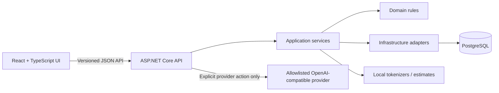

# ContextBudget

**Inspect LLM context usage, review optimization candidates, and compare measured A/B outcomes.** ContextBudget is a local-first workspace for teams evaluating prompt and context efficiency. It keeps provider-reported usage separate from local token estimates and never treats fewer tokens as proof of a better answer.

> **V1 status:** locally verified for the checks listed below. The live EVREN integration has not been verified. The application has no authentication and is intended only for local or private-network use; do not expose it directly to the public internet.

## Problem statement

LLM traces often contain repeated context, retrieval chunks, tool output, and usage data spread across systems. It can be difficult to see what consumes tokens, assess safe reductions, and compare cost or latency without conflating estimates with provider measurements. ContextBudget brings trace inspection, review-only suggestions, offline evaluation, explicitly started A/B runs, and transparent cost estimates into one workspace.

## Key features

- Import JSON traces and inspect context segments, token usage, and deterministic findings.
- View optimization candidates and side-by-side changes; suggestions do not modify input automatically.
- Create immutable dataset fingerprints and run paired A/B experiments with 1–3 repeats.
- Evaluate configured exact-match, keyword/fact, JSON/schema, instruction-presence, and manual-review checks.
- Compare paired latency and provider-reported usage with sample-qualified statistics.
- Maintain dated pricing profiles and inspect calculated inference cost separately from actual billing.
- Persist project and analysis metadata in PostgreSQL while avoiding raw prompt and response retention by default.
- Use an optional server-side OpenAI-compatible provider adapter. Provider requests occur only after an explicit user action.

## Screenshots

Screenshots are not included yet. The dashboard and feature pages require a populated local database; repository fixtures are synthetic, but a repeatable UI capture has not been saved. No mock or illustrative screenshot is presented as a real application capture. Add verified captures under [`docs/screenshots/`](docs/screenshots/) when available.

| Screen | Preview |
| --- | --- |
| Dashboard | _Screenshot pending_ |
| Context Analyzer | _Screenshot pending_ |
| Optimization Studio | _Screenshot pending_ |
| Experiments | _Screenshot pending_ |
| Cost & Performance | _Screenshot pending_ |

## Architecture



The backend is a modular monolith divided into Domain, Application, Infrastructure, and API projects. The frontend is a separate Vite application. See [architecture](docs/ARCHITECTURE.md), [database design](docs/DATABASE_DESIGN.md), and [API contracts](docs/API_CONTRACTS.md).

## Technology stack

- .NET 10, ASP.NET Core Minimal APIs, EF Core, PostgreSQL
- React 19, TypeScript, Vite, TanStack Query, Vitest
- Docker Compose for an optional local full-stack run
- GitHub Actions for backend and frontend CI

## Requirements

- .NET 10 SDK
- Node.js 24 and npm (the frontend CI uses Node 24)
- Docker Desktop with Compose, or a local PostgreSQL instance

## Installation and local development

Clone the repository, then prepare local configuration from the sample file. `.env` is ignored by Git; keep real credentials there or in a local secret store.

```bash
cp .env.example .env
```

PowerShell equivalent:

```powershell
Copy-Item .env.example .env
```

Set a local-only PostgreSQL password in `.env`. The sample value is for disposable development only. Never reuse it outside a local environment. Alternatively, run PostgreSQL yourself and set `ConnectionStrings__Postgres` in the API process environment.

### Run the API and UI separately

Start PostgreSQL through Compose:

```bash
docker compose up -d postgres
```

Start the backend in one terminal:

```bash
# Set the same local-only password you placed in .env.
export ConnectionStrings__Postgres='Host=localhost;Port=5433;Database=contextbudget;Username=contextbudget;Password=your-local-password'
dotnet run --project src/ContextBudget.Api --urls http://localhost:5080
```

In PowerShell, set it with `$env:ConnectionStrings__Postgres = 'Host=localhost;Port=5433;Database=contextbudget;Username=contextbudget;Password=your-local-password'` before running `dotnet run`.

Start the frontend in another terminal:

```bash
cd web
npm ci
npm run dev
```

Open <http://localhost:5173>. The API health endpoint is <http://localhost:5080/health>. In Development, the API applies migrations on startup; in other environments migrations are not applied automatically unless explicitly enabled. OpenAPI is exposed in Development.

### Optional provider configuration

Offline inspection, deterministic evaluation, and local analytics do not require an API key. The optional OpenAI-compatible adapter is configured on the server for the EVREN Gateway hostname. Configure `Providers__OpenAICompatible__ApiKey` through an environment variable or .NET User Secrets; do not put a key in frontend configuration, source files, or screenshots. The provider test action sends a real request and may consume tokens. Live EVREN connectivity and model availability have not been verified for this release.

## Docker Compose

Copy `.env.example` to `.env`, set a development database password, then run:

```bash
docker compose up --build
```

Open <http://localhost:5173>. The web UI and PostgreSQL ports bind to loopback. To stop the services, use `docker compose down`. To remove the local database volume as well, use `docker compose down --volumes` (this deletes local development data).

## Example workflow

1. Create a project and import the synthetic trace in [`examples/sample-trace.json`](examples/sample-trace.json).
2. Review usage metadata, token estimates, and analysis findings in Context Analyzer.
3. Inspect optimization candidates in Optimization Studio and decide manually whether to use them.
4. Create a dataset from synthetic evaluation cases and define baseline and optimized contexts.
5. Review the displayed request count, then explicitly start an A/B experiment. This step calls the configured provider; offline setup does not.
6. Review deterministic quality gates, latency, usage, and calculated cost. Enter a dated pricing profile to enable cost calculations. Unknown inputs stay unavailable rather than being reported as zero.

Experiment source cases and candidate contexts must be resubmitted when starting a run. Their fingerprints and result metadata persist, not the raw case or response text.

## Tests and verification

Run locally:

```bash
dotnet restore ContextBudget.slnx
dotnet build ContextBudget.slnx --configuration Release --no-restore
dotnet test ContextBudget.slnx --configuration Release --no-restore
cd web
npm ci
npm test
npm run build
```

The PostgreSQL integration test is gated by `CONTEXTBUDGET_TEST_DB`. Point it at a disposable database to run it locally. Without the variable, the integration test is skipped and PostgreSQL behavior is not verified by that run. GitHub Actions provisions PostgreSQL and sets this variable so the test is included in CI.

Local release verification recorded in [PROGRESS.md](PROGRESS.md): backend Release build passed with no warnings/errors; backend tests with temporary PostgreSQL passed (49, none skipped); frontend tests passed (8); frontend production build passed; API persistence/restart and isolated Compose smoke checks passed. These are local results. The GitHub Actions workflow has not yet been run on GitHub.

## Security model

- No authentication or user/tenant separation is implemented. Use only on a trusted local machine or isolated private network; do not publish the API or UI to the internet.
- CORS is restricted to the local Vite origin. API request bodies and imported content are size-limited and validated.
- Trace segment hashes, metadata, estimates, and provider usage can persist; raw prompt content is not stored by default. Experiment history stores fingerprints and metrics, not raw cases, contexts, or model responses.
- Provider credentials are server-side configuration, are not returned by the API, and are not logged. Provider destinations are restricted by HTTPS hostname allowlisting and public-address checks; redirects and proxy use are disabled.
- `.env`, build output, dependency directories, and local IDE files are ignored. The `.env.example` contains sample-only configuration, not production credentials.
- Local database credentials are development-only. Never expose the Compose database or reuse sample credentials in a deployed environment.

## Limitations

- Live EVREN connectivity, credentials, and the configured model were not verified. No live provider request was used for release verification.
- Token counts are marked estimated unless a compatible trusted local tokenizer vocabulary is configured; counts omit provider-specific chat framing.
- Optimization suggestions are review-only. Deterministic checks do not establish semantic correctness, and no LLM judge or tool execution is included.
- The experiment queue is in-process, single-instance, and not durable; queued work is not recovered after process termination.
- Cost is a calculated estimate from provider-reported usage and manually maintained prices, not live billing. There is no FX conversion, judge cost, or optimization-generation cost.
- The API has no authentication and is not hardened for public or multi-tenant deployment.

## Future roadmap

The current roadmap is in [`docs/ROADMAP.md`](docs/ROADMAP.md). Follow-up work includes optional LLM-as-a-Judge evaluation, a durable multi-instance experiment queue, broader API end-to-end coverage, production deployment hardening, and measured billing/provider integrations where reliable data sources exist. A remote GitHub Actions run remains a release follow-up; live EVREN verification is optional and requires credentials and authorization.

## Release

See [`CHANGELOG.md`](CHANGELOG.md) for the v1.0.0 release notes and [docs/ROADMAP.md](docs/ROADMAP.md) for remaining release follow-ups.
